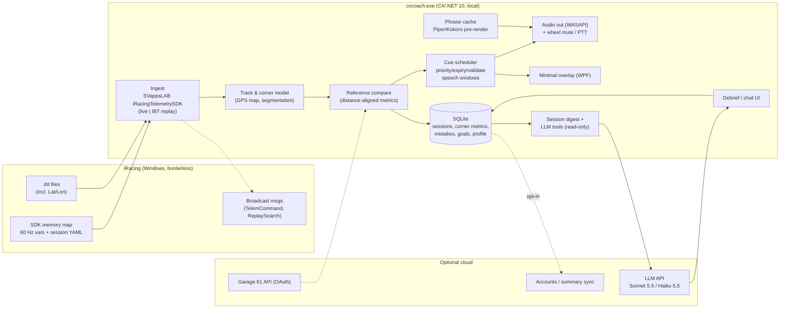

# cocoach: technology and architecture research (scout report)

- Task: `cocoach-tech-research`. This report covers the technology and architecture half. A sibling scout covers the market and competitors.
- Date: 2026-11-09. Repository state: `cocoach` holds only `1098284 chore: initial commit`. There is no code yet.
- Deliverables: this report, plus `AGENTS.md.draft` in the same directory.

---

## 0. Verdicts in one screen

| Question | Verdict |
|---|---|
| Primary signal | **Telemetry from the official iRacing SDK.** Screen vision is not a viable primary signal for live cues: it is too slow, too costly, and adds little that telemetry lacks. Vision becomes a later, offline or low-rate *enrichment* experiment (section 2.8). |
| Live coaching engine | **Deterministic code, local, LLM-free.** Live cues are scheduled by track distance from a reference-lap model. An LLM never sits on the live critical path. |
| Live voice | **Pre-rendered phrase cache.** Phrases are synthesised by local TTS (Piper or Kokoro) before or between sessions, then played as clips. A cue must *start* 0.9–1.5 s before the action point, which is 50–120 m at 200–280 km/h. One driver-facing message at a time, with priorities and expiry, and never mid-corner. |
| LLM role | **Post-session debrief and chatbot, plus optional between-lap insights.** The LLM gets compact corner tables and tool calls over a local SQLite store, never raw 60 Hz data. Cost is about $0.02 per session (Haiku 5.5) up to about $0.45 per session uncached (Sonnet 5.5). |
| Memory | **Structured first, semantic second.** SQLite tables for sessions, laps, corner statistics, recurring mistakes and goals, plus a small LLM-curated "driver profile" fact list. A memory framework (Mem0/Zep/Letta) is not needed for the MVP. |
| Desktop stack | **C#/.NET 10, Windows-only.** A tray app using `SVappsLAB/iRacingTelemetrySDK` (Apache-2.0, with live and IBT replay behind one API), SQLite, NAudio/WASAPI playback, minimal WPF overlays, and Velopack plus code signing. |
| iRacing rules | Read-only use of the SDK is the established, tolerated path. Memory reading, injection, input automation and sim modification are forbidden. The **Aug-2026 EULA §6.1(d) explicitly names "artificial intelligence (AI), AI models"**, and §6.1(e)/(f) restrict data collection and resale. This is a grey area for an AI coach. Get legal review before any commercial launch (section 3). |
| MVP | Phase 1 is "own-reference brake/throttle coach plus LLM debrief" for practice sessions, built and tested entirely against recorded `.ibt` replays (section 8.2). |

---

## 1. Method (what I did)

All web research went through DeepAPI, as `~/.claude/CLAUDE.md` requires.

- **7 parallel `POST /v1/research/deep` runs** (raw mode, $0.625 cap each, all `completeness: complete`). Each returned 72k–115k characters of cited evidence:

  | Topic | requestId |
  |---|---|
  | SDK | `2597ba37-e256-40a1-ad29-2514108f9957` |
  | Rules | `3ac610be-a3b0-43ca-b171-a11ff98e244c` |
  | Vision | `b7a5b94f-c252-48e9-947b-d8cbc95fd2d8` |
  | Coaching engine | `cb75afca-5863-4d19-abcd-85db8259bd79` |
  | Voice | `3bafaed6-7ca9-40af-b605-9093ef12443f` |
  | LLM/memory | `ad9280c7-1432-4f09-9962-6a334af7c9aa` |
  | Stack | `adf808dc-43cd-4358-9cf1-64caffe64c99` |

  These can be re-fetched free with `GET /v1/requests/{id}`.
- **8 `POST /v1/scrape/github/search` runs**: `irsdk`, `iracing sdk` (C#), `iracing telemetry` (Rust, TypeScript), `iracing` (Python), `iracing overlay`, `iracing coach`, and `ibt telemetry`. There was also a code search inside `mrbelowski/CrewChiefV4`.
- **Primary-source scrapes:**
  - The iRacing EULA PDF dated 2026-08-05 (`ef8703b7-…`).
  - `irsdk_defines.h` from `vipoo/irsdk`, a clone of the official SDK (`8f9928d4-…`).
  - Crew Chief `QueuedMessage.cs`.
  - Official pricing pages: Anthropic, OpenAI and Google, plus the Gemini Live docs (`96bf3853-…`).
  - Claude vision docs and Gemini token docs (`4dfd0ae8-…`).
  - The Garage 61 developer docs and two GitHub issues about Lat/Lon (`1dcbc6bc-…`).
  - GitHub repo metadata (license and last push) for 5 candidate libraries.
- **7 `POST /v1/search/web` runs**: Garage 61 API, `.ibt` GPS channels, live X/Y absence, OpenKneeboard VR overlays, vision-based coaching apps, and `.blap`/`.olap` ghost files.
- **One throwaway experiment**, `experiments/budget.py`, a latency and cost calculator in the disposable worktree. Its full output is reproduced in sections 2.8, 4.6 and 6.5.
- I did **not** run iRacing. The scout environment is Linux and has no sim. Every SDK fact comes from the SDK header, library source or docs, and is marked where it is community-reported rather than official.

---

## 2. Data acquisition

### 2.1 How the live SDK works (primary source: official SDK header)

Source: `irsdk_defines.h` (https://github.com/vipoo/irsdk/blob/master/irsdk_defines.h, a clone of iRacing's C++ SDK). Line numbers refer to that file.

- **Transport.** iRacing writes a Windows memory-mapped file `Local\IRSDKMemMapFileName` and signals the event `Local\IRSDKDataValidEvent`. Broadcast commands go through the window message `IRSDK_BROADCASTMSG` (lines 86–88). Any language that can open a memory-mapped file can read it (lines 36–40). Memory telemetry must be enabled with `irsdkEnableMem=1` in `Documents\iRacing\app.ini`, as the IRSDKSharper NuGet page (https://www.nuget.org/packages/IRSDKSharper) and the Sim Racing Studio troubleshooting page (https://simracingstudio.freshdesk.com/support/solutions/articles/35000154494-iracing-troubleshooting) both note.
- **Rate.** "Variables … are output at a rate of 60 times a second … The sim writes a new line of variables every 16 ms … we triple buffer it … This gives you a minimum of 16 ms to read the data out … best to copy the data out before processing it" (lines 48–63). The header has `int tickRate; // ticks per second (60 or 360 etc)` (line 306), and `numBuf <= IRSDK_MAX_BUFS (3 for now)` (lines 90, 318).
- **Two data kinds.** Session info is a YAML string that changes rarely; `sessionInfoUpdate` increments when it changes (line 309). Variables are a binary row described by `varHeader` entries. "The number of variables … can change depending on the car or session loaded. But once the sim is running the variable list is locked down" (lines 51–55).
- **Layout.** The live header is 112 B. A 512 KB region is reserved for the YAML, followed by the variable headers (144 B each) and the row buffers. Source: SVappsLAB ARCHITECTURE.md, https://github.com/SVappsLAB/iRacingTelemetrySDK/blob/main/docs/ARCHITECTURE.md.
- **Logged data.** `.ibt` files "directly mirror the format of the live data", plus an `irsdk_diskSubHeader` (lines 66–75). Logging is toggled in the sim with Alt-L, or by an external app through `irsdk_BroadcastTelemCommand` Start/Stop/Restart (lines 370, 400–404).
- **360 Hz logging.** `irsdkLog360Hz=0` in app.ini, off by default, enables 360 Hz *disk* logging of some channels (Crew Chief forum: https://thecrewchief.org/showthread.php?1751-CC-Fails-under-360Hz-telemetry; iRacing 2017 S1 release notes: https://www.iracing.com/2017-season-1-release-notes/). The live feed stays 60 Hz. A community doc lists newer `_ST` "sub-tick" variants such as `YawRate_ST`, `VelocityX_ST`, `LatAccel_ST` (https://gist.github.com/teknologika/0127fa9a031ec686537277a954972ad0). These should be verified against a real session in Phase 0.

### 2.2 Variables that matter for coaching

Units are from the community variable docs: https://sajax.github.io/irsdkdocs/ and the teknologika gist above.

| Purpose | Variables (live, 60 Hz) |
|---|---|
| Driver inputs | `Throttle`, `Brake` (0–1), `ThrottleRaw`, `BrakeRaw`, `Clutch`, `SteeringWheelAngle` (rad), `Gear`, `RPM`, `BrakeABSactive` |
| Vehicle state | `Speed` (m/s), `VelocityX/Y/Z` (m/s, car frame), `Yaw`, `YawNorth`, `Pitch`, `Roll` (rad), `YawRate` (rad/s), `LatAccel`, `LongAccel`, `VertAccel` (m/s², include gravity) |
| Position along lap | `LapDist` (m), `LapDistPct` (0–1), `Lap`, `LapCompleted`, `LapCurrentLapTime`, `LapLastLapTime`, `LapBestLapTime` |
| Built-in deltas | `LapDeltaToBestLap`, `LapDeltaToOptimalLap`, `LapDeltaToSessionBestLap` (+ `_OK` flags). These are useful as ground truth for our own delta. |
| Track surface / limits | `PlayerTrackSurface` (`irsdk_TrkLoc`: off-track / pit stall / approaching pits / on-track, lines 185–191), `PlayerTrackSurfaceMaterial` (name per community docs; verify in Phase 0) (`irsdk_TrkSurf`: asphalt, concrete, **Rumble1–4** (kerbs), grass, dirt, sand, gravel; header lines 193–225), and per-tyre kerb channels `TireLF/RF/LR/RR_RumblePitch` (new; SimHub iRacing plugin changelog, https://www.xsimulator.net/community/threads/iracing-plugin.4774/page-9) |
| Context | `IsOnTrack`, `OnPitRoad`, `SessionState`, `SessionFlags`, `PlayerCarMyIncidentCount`, `CarIdxLapDistPct[64]` (everyone's position along the lap), `CarIdxOnPitRoad[64]`, tyre and brake temperatures (car-dependent) |

**Not available live: world X/Y position (`Lat`, `Lon`, `Alt`).**
- They read as zero over the live SDK (https://github.com/NickThissen/iRacingSdkWrapper/issues/5; https://github.com/apihlaja/node-irsdk/issues/63; https://forum.virtualracing.org/threads/iracing-api-gps-positionierung-auf-der-strecke.120343/).
- They *are* present in `.ibt` files. The IBT channel list includes `Alt`, `Lat` and `Lon` (https://github.com/naizens/TRACE.IT/blob/main/docs/ibt-channels.md), and MoTeC/Mu GPS track maps are built from them (https://github.com/patrickmoore/Mu).
- This is the one real gap a vision system could fill: lateral position relative to the track edges. Section 4.1 shows how to cover it from telemetry instead.

### 2.3 Session info YAML (key sections)

- `WeekendInfo`: track id, name, config, length, `TrackNumTurns`, weather, session type, official flag.
- `SessionInfo`: session list with types (practice, qualify, race) and results.
- `SplitTimeInfo`: sector start percentages.
- `DriverInfo`: `DriverCarIdx`, the car list (`CarScreenName`, `CarPath`), and **every driver's `UserName` and `UserID` (custid)**. That last item matters for privacy (section 3).
- `CarSetup`: setup values.

Spec: https://sajax.github.io/irsdkdocs/yaml/. Re-parse the YAML only when `sessionInfoUpdate` changes.

### 2.4 Broadcast API (write-side, allowed commands only)

Header enum (lines 358–373):
- camera switch and state
- replay speed, position, search and state
- reload textures
- chat command (macros)
- pit command, which only works with the driver in the car: fuel, tyres, fast repair, windshield (lines 384–397)
- telemetry start/stop/restart
- FFB command
- replay search by session time

For cocoach, **TelemCommand** is the useful one: it can auto-record an `.ibt` for every session so the app always has GPS-bearing data for track maps and reference laps. **Replay search** enables a post-race "jump to the corner" in the debrief. Never use chat or pit commands without explicit driver action.

### 2.5 Maintained libraries (GitHub search plus repo metadata, 2026-11-09)

| Language | Library | Stars | License | Last push | Notes |
|---|---|---|---|---|---|
| C# | **SVappsLAB/iRacingTelemetrySDK** | 29 | **Apache-2.0** | 2026-10-12 | Source-generated strongly typed variables. **Live or IBT-file playback through the same client.** Bounded non-blocking channels, "recency over completeness". Separate session-YAML stream. Best fit. https://github.com/SVappsLAB/iRacingTelemetrySDK |
| C# | mherbold/IRSDKSharper | 37 | **GPL-3.0** | 2026-07-24 | Capable, but **GPL would force a closed commercial app to be open-sourced**. https://github.com/mherbold/IRSDKSharper |
| C# | NickThissen/iRacingSdkWrapper | 97 | — | 2026-09-18 | Older, widely used wrapper. https://github.com/NickThissen/iRacingSdkWrapper |
| Python | kutu/pyirsdk | 398 | MIT | 2026-10-03 | Most popular SDK binding overall, and reads `.ibt` too. Good for analysis notebooks. https://github.com/kutu/pyirsdk |
| Node/TS | bengsfort/irsdk-node | 34 | MIT | 2026-08-22 | Native addon. Its README says it can use and control the SDK. https://github.com/bengsfort/irsdk-node |
| Node | apihlaja/node-irsdk | 120 | — | — | Older. https://github.com/apihlaja/node-irsdk |
| Rust | adnanademovic/simetry (47), LeoAdamek/iracing.rs (27), racedirector/iracing.rs (4) | — | — | 2026 | Smaller, multi-sim (simetry). |
| Go | LeonB/irsdk-go, quimcalpe/iracing-sdk | <10 | — | — | Thin. |
| IBT parsers | SkippyZA/ibt-telemetry (JS, 94), gmartsenkov/itelem (Rust), teamjorge/ibt (Go), m3rlin45/libibt (Rust core + PyO3) | | | | |

Notable open-source reference apps:
- **irdashies**: Electron, React and TypeScript, MIT, 270★, pushed today (https://github.com/tariknz/irdashies).
- **SharpOverlay**: .NET WPF (https://github.com/TiberiuC39/SharpOverlay).
- **Crew Chief**: C# .NET 4.7.2, voice (https://github.com/mrbelowski/CrewChiefV4).
- **trailbrake**: Tauri, Rust and React (https://github.com/isaachansen/trailbrake).
- **RaceIQ**: TypeScript, multi-sim lap analysis (https://github.com/SpeedHQ/RaceIQ).
- Several hobby "AI coach" repos already exist. One example is a Python/Qt "live AI pit crew" reading 60 Hz telemetry (https://github.com/kruslim/racing-telemetry-visualiser). The idea is not novel at the hobby level; the moat is cue quality.

### 2.6 Gotchas

- Copy the row out within 16 ms. Never parse YAML on the telemetry thread.
- The variable set varies by car, so look variables up by name and handle their absence.
- Lat/Lon are not live (above).
- Telemetry only flows while the sim is running and in a session.
- 360 Hz logging has caused problems for some third-party apps (Crew Chief thread above).

### 2.7 iRacing VR and fullscreen

- Desktop overlays (transparent topmost windows) **do not draw over exclusive fullscreen**. iRacing must run windowed or borderless, which is how RaceLab and others document it (https://garage.racelab.app/docs/first-steps/iracing/; https://rlasupport.jdwinelist.com/contents/en-uk/d1033_quick-tips.html).
- **In VR, desktop overlays are invisible.** VR needs SteamVR overlays or an OpenXR API layer such as OpenKneeboard, which iOverlay and others use (https://github.com/OpenKneeboard/OpenKneeboard; https://ioverlay.app/downloads/docs/vr/iOverlayVR_OpenKneeboard.pdf).
- **This is a strong argument for voice as the primary channel:** it works identically on monitors and in VR.

### 2.8 The captain's "see my live screen" idea: candid evaluation

**Capture APIs (Windows).**
- **Windows.Graphics.Capture (WGC)** is the right choice if we ever capture. It gives a per-window GPU texture through DWM, with no injection into the game, and it works when the window is occluded. Capture by HWND needs Windows 10 1903+. The yellow capture border can be removed on Windows 11 with consent. It **cannot capture exclusive fullscreen** and is capped at the monitor refresh rate. Sources: https://ryanzh.me/en/blog/pc-window-capture and https://learn.microsoft.com/en-us/windows/apps/develop/media-authoring-processing/screen-capture.
- **DXGI Desktop Duplication** works per monitor rather than per window, so overlays and the cursor end up in the frame. It allows only one duplication per output per process, and a session allows four duplicating processes by default (https://learn.microsoft.com/en-us/windows/win32/direct3ddxgi/desktop-dup-api). One developer reports capture time of about 0.25 ms versus about 10 ms for BitBlt (r3 evidence; https://sageinfinity.github.io/docs/FAQ/dxgiwgc).
- **Hook or injection capture**, as in OBS "game capture", must not be used: it injects into the game process, which the EULA anti-cheat clauses target (section 3).
- Since overlays already require borderless mode, WGC adds no new constraint. Capture cost itself is negligible. **The model is the bottleneck, not capture.**

**Vision models: the experiment output** (`python3 -I experiments/budget.py`, section 2).

Assumptions: input tokens only, 1280×720 frames, live prices scraped 2026-11-09. Claude visual tokens are ⌈w/28⌉×⌈h/28⌉ per https://platform.claude.com/docs/en/build-with-claude/vision. Gemini counts 258 tokens per 768² tile per https://ai.google.dev/gemini-api/docs/tokens.

```
frame (1280, 720): Claude 1196 tokens, Gemini 516 tokens
1 fps: claude-haiku-5-5=$0.43, claude-sonnet-5-5=$8.61, claude-opus-5-5=$17.22, gemini-3.8-flash=$1.39, gemini-3.5-flash-lite=$0.56, gpt-realtime-2.1 (image)=$21.53, gpt-realtime-2.1-mini (image)=$3.44
2 fps: claude-haiku-5-5=$0.86, claude-sonnet-5-5=$17.22, claude-opus-5-5=$34.44, gemini-3.8-flash=$2.79, gemini-3.5-flash-lite=$1.11, gpt-realtime-2.1 (image)=$43.06, gpt-realtime-2.1-mini (image)=$6.89
5 fps: claude-haiku-5-5=$2.15, claude-sonnet-5-5=$43.06, claude-opus-5-5=$86.11, gemini-3.8-flash=$6.97, gemini-3.5-flash-lite=$2.79, gpt-realtime-2.1 (image)=$107.64, gpt-realtime-2.1-mini (image)=$17.22
gemini-3.8-live: video/image input billed $0.002/min at <=1 FPS => $0.12/h input
```

OpenAI image tokenisation differs, so its rows use the Claude token count as a stand-in and are only indicative.

The cheapest streaming option, the Gemini 3.8 Live API, **accepts images as "JPEG <= 1FPS"** (https://ai.google.dev/gemini-api/docs/live, technical specifications). At 280 km/h the car travels **78 m between frames**. Any request/response vision path also adds model latency on top: I did not measure it, and none of the vendor docs guarantees a figure, so plan for roughly 0.5–2 s. Section 4.6 shows that a brake cue must *start* 0.9–1.5 s before the brake point. A cue built from a frame that is 1–2 s old arrives too late at the exact moment it matters most.

**What vision would add over telemetry:**
1. Lateral position relative to the track edges and kerbs. Telemetry has no live X/Y, but kerb contact *is* in telemetry via `PlayerTrackSurfaceMaterial` (Rumble) and `Tire*_RumblePitch`.
2. Visual references such as brake boards and turn-in markers, for cues like "brake at the 100 board".
3. Other cars' lateral positions. Telemetry gives only distance along the lap; spotting is a separate product area.
4. Weather and visibility. Telemetry has weather variables anyway.

**What it costs:**
- $0.4–$17 per hour at 1 FPS for Claude models, and more at higher frame rates.
- GPU contention if run locally. iRacing's physics runs at a fixed 60 Hz, mostly CPU-bound (https://simracingcockpit.gg/iracing-cpu-gpu-technical-deep-dive/), and VR or triple-screen setups load the GPU heavily.
- It is unreliable in VR, where the desktop mirror window is not what the driver sees.
- Every driver's HUD and camera setup is different.

Research systems that drive from pixels, such as the vision-based Gran Turismo agent (https://arxiv.org/abs/2406.12563), are trained end-to-end controllers. They are not coaches.

**Verdict: telemetry-primary, vision off the live path.** Treat vision as a Phase 3 experiment in two forms:
- **(a) Offline per-track calibration.** Analyse a recorded replay once to name visual references (boards, kerbs) and cache them in the track model.
- **(b) Post-session review.** Show "your line vs reference" on captured frames.

Neither form needs real-time inference. The captain should confirm this re-scoping of the idea (section 8.5).

---

## 3. iRacing rules: what is allowed and what is forbidden

Primary sources:
- **Terms of Use & EULA, Aug 05 2026**: https://ir-core-sites.iracing.com/members/pdfs/20260805-iRacing_Terms_of_Use_and_EULA_dated_Aug_05_2026.pdf (scraped in full, 16 pages).
- **Official Sporting Code v2025.09.09**: https://ir-core-sites.iracing.com/members/pdfs/20250909-official_sporting_code_dated_Sep_09_2025.pdf.
- **Support article "Third-Party Development"**, modified 2026-10-01: https://support.iracing.com/support/solutions/articles/31000179757-third-party-development-please-review-the-iracing-terms.

**Explicitly established or allowed**

- iRacing ships the SDK so external apps can read the live data. The header says "Any application can open this memory mapped file and read the telemetry data out" (`irsdk_defines.h` lines 36–38).
- iRacing "does not review, pre-approve, or grant authorization to third parties who develop software that works alongside the simulation… Usage of the iRacing SDK, the iRacing /data API, and the data they provide is governed by the terms members agree to" (support article). **There is no approval process. Compliance is the developer's and the user's responsibility.**
- Streaming your own POV is allowed under the Broadcast Policy (EULA §6.4; https://s100.iracing.com/wp-content/uploads/2021/03/v2021-02-01-iRacing-Broadcast-Policy.pdf). Screen recording for personal review is therefore normal practice.
- Community norm: SDK-based companion apps are ubiquitous and used in official races. These include voice spotters (Crew Chief), overlays (RaceLab, iOverlay, Kapps, SimHub), telemetry and ghost tools (Garage 61, VRS, Coach Dave Delta), and *real-time AI voice coaches* (Trophi.ai "Mansell coaches you corner by corner in real time", https://www.trophi.ai/sim-racing/). I found no iRacing statement banning them.

**Explicitly forbidden**

- **EULA §6.1(d):** "create or use cheats, bots, 'mods', **artificial intelligence (AI), AI models**, and/or hacks, or any other non-iRacing software or other technology designed to cheat in or otherwise modify the iRacing experience".
- **EULA §6.1(e):** "use any software or other device that intercepts, 'mines', or otherwise collects information (including the Data) from or through the Service".
- **EULA §6.1(f):** "sell, resell, or make available to any third party … the Data … in exchange for anything of value". "Data" is defined to include "data and statistics generated as a result of your use of the Service" (EULA p.3), which covers telemetry.
- **EULA §6.3:** no commercial exploitation of the Service or Data without written consent.
- **EULA §6.5:** no intercepting or emulating protocols, packet sniffing, or "adding unauthorized components to the Sim Client". Connections only "through methods and means expressly approved by iRacing".
- **EULA §6.7 and §20.1 (anti-cheat):** a third-party anti-cheat client "scanning the memory of the Sim". The sim "may monitor your computer's RAM for unauthorized programs", meaning software that enables cheating, modifies the sim, or "intercepts, 'mines,' or otherwise collects information from or through the Sim". Note the vendor history: the 2024 S2 Patch 4 notes say EasyAntiCheat was removed and Epic Online Services anti-cheat restored (https://support.iracing.com/support/solutions/articles/31000173098-2024-season-2-patch-4-release-notes-2024-05-01-02-).
- **Sporting Code 8.1.1.2, Automated Driving Inputs:** "Drivers may not utilize third-party software and/or hardware to modify or automate direct real-time human control inputs to the iRacing simulation". **Sporting Code 8.1.1.4, Cheating:** "conduct deemed by iRacing to be in conflict with the spirit or intent of the Simulation".
- **Support article:** third parties "may not display, publish, or otherwise expose a member's display name or customer identifier (ex. custid) in any context without that member's explicit, affirmative, and revocable consent." The session YAML carries every opponent's name and custid.
- **Sporting Code 5.2.2.1:** iRacing owns all rights to "images, sounds and data … arising from or during any iRacing.com-sanctioned event".

**Grey areas (be candid)**

1. **A literal reading of §6.1(e) would ban every telemetry app.** Yet iRacing ships the SDK and points SDK users to the same terms. In practice, SDK reading is tolerated. That tolerance is iRacing's discretion, and they "may restrict or remove access to various data at its discretion" (support article).
2. **§6.1(d) names AI explicitly in the 2026 EULA.** The qualifier is "designed to cheat in or otherwise modify the iRacing experience". A coach that only reads SDK data and speaks to the driver is not designed to cheat, but "modify the iRacing experience" is broad. Competitors operate openly, which is evidence of tolerance, not permission.
3. **Commercial cloud processing of telemetry** brushes against §6.1(f) and §6.3. Garage 61, VRS and Track Titan operate this way.
4. **Real-time coaching during *official* races.** No rule forbids audio information. Spotters and delta bars are normal. Corner-by-corner coaching in ranked races is newer and could be argued against under "spirit or intent". This is a product decision (section 8.5).

**Engineering rules this implies** (they belong in AGENTS.md):
- Only touch the SDK memory map, `.ibt` files, iRacing's documented broadcast messages, and the OAuth `/data` API.
- Never read or write sim process memory, inject, hook, or modify sim files.
- Never synthesise or alter driver inputs (no vJoy-style "assist").
- Never capture with injection-based game capture.
- Strip other drivers' names and custids before anything leaves the PC or reaches an LLM, unless the user consents for themself.
- Do not resell raw telemetry.
- **Before a commercial launch, get a legal read on §6.1(d)–(f) and §6.3, or seek written consent from iRacing.**

---

## 4. Coaching engine

### 4.1 Track model without live X/Y

1. **Track geometry from `.ibt` GPS.**
   - Auto-start disk telemetry with `irsdk_BroadcastTelemCommand(Start)` when the car is on track, so every session yields an `.ibt` with `Lat`/`Lon`/`Alt` at 60 Hz, or at 360 Hz for some channels when enabled.
   - Convert to a local ENU frame.
   - Build a centreline as a function of `LapDist` by averaging clean laps.
   - Estimate track edges from the lateral envelope of many laps, plus surface-material transitions (Rumble, Grass) and `PlayerTrackSurface == OffTrack` events.
2. **Live position.**
   - Use the live `LapDist`/`LapDistPct` as the longitudinal coordinate. It is authoritative and drift-free.
   - For lateral position, dead-reckon from `VelocityX/Y` rotated by `Yaw`/`YawNorth`, integrated over short windows and re-anchored to the map at each `LapDist`. Drift stays small over a corner-length window.
   - Kerb usage comes directly from `PlayerTrackSurfaceMaterial` and `Tire*_RumblePitch`.
3. **Fallback with no `.ibt` yet.** Build the 2-D map by integrating speed and yaw over a lap, with loop-closure correction at the start/finish line. This is the classic approach for overlay track maps.

### 4.2 Corner segmentation (deterministic)

- Use curvature κ = YawRate / Speed (or the GPS-derived heading rate) as a function of `LapDist`, smoothed.
- A corner is a contiguous region where |κ| exceeds a threshold, merged across short gaps, and split at sign changes for esses.
- Refine boundaries with braking onset (Brake > ~5 %, LongAccel < threshold) and full-throttle return.
- Key points per corner:
  - **brake point**: first sample with brake > 5 % on approach
  - **peak brake** and **release/trail profile**
  - **turn-in**: |steering| rising past threshold
  - **apex**: minimum speed or maximum |κ|
  - **throttle pickup**: Throttle > 10 % sustained
  - **full throttle**
- Persist corner definitions per (track id, config) and let them be named. `WeekendInfo.TrackNumTurns` provides a sanity check.

### 4.3 Lap alignment and reference comparison

- Resample every lap onto a fixed `LapDist` grid (for example 1 m). Distance alignment, not time alignment, is standard. A delta-time trace accumulates from speed ratios.
- Per-corner metrics against the reference:
  - brake-point offset in metres (+ = early)
  - peak brake pressure and release slope (trail-brake shape)
  - entry speed
  - **minimum-speed difference**
  - apex location
  - throttle-pickup offset in metres
  - time lost or gained in the entry, mid and exit sub-segments
  - kerb usage
  - lateral-line offset (when GPS maps exist)
- Cross-check against iRacing's own `LapDeltaToBestLap`/`LapDeltaToOptimalLap`.

### 4.4 Reference-lap sources

| Source | Access | Notes |
|---|---|---|
| Driver's own best lap / **optimal composite** (best per corner) | Local `.ibt` | Always available, no licensing issue. Best MVP choice. |
| iRacing `.blap`/`.olap` ghost files | Local files in per-track folders under `Documents\iRacing\` (https://www.overtake.gg/threads/iracings-best-kept-secret.33767/) | Proprietary format. Useful as an in-sim ghost, not as a data source. |
| **Garage 61 API** | OAuth2 or personal token. `GET /api/v1/laps`, `/laps/{id}/csv` (telemetry CSV), `/laps/{id}/ghost.bin` (https://garage61.net/developer/endpoints) | "There is no API stability yet". Data is limited to what the authenticated user can see: "There is no API to access and export all the data … The reason for this is privacy". Rate-limited. Do not use internal endpoints (https://garage61.net/developer/getting-started). The best third-party reference pool for users who already use Garage 61. |
| VRS, Coach Dave Delta, Track Titan, setup shops' `.ibt` data packs | Paid products. No open API found. | Users can import `.ibt` files they own. Partnerships would be a business deal. |

### 4.5 Deterministic versus model-driven

| Must be deterministic (live loop and numbers) | Model-driven (LLM) |
|---|---|
| Telemetry ingest, lap/corner segmentation, distance alignment, all metrics and deltas | Turning the computed corner table into prioritised, plain-language advice after the session |
| Choosing *which* live cue to say, *when* (distance-scheduled), and rate limiting | Session debrief, Q&A chat, "why am I slow in T7?", explaining trade-offs |
| Safety gates: silence off-line, under yellow, in traffic, mid-corner | Curating long-term memory (recurring-mistake summaries, goals) |
| Every number the LLM is allowed to say comes from tools | Optional between-lap one-liners on the straight, generated *asynchronously* and spoken only via the scheduler |

The LLM may choose wording; it must never invent a number or a timing.

### 4.6 Latency budget (experiment output)

Assumptions:
- pipeline: one 60 Hz tick plus processing, about 30 ms
- audio start: 20 ms for a pre-rendered clip, 60 ms for warm local GPU TTS, 300 ms for cloud TTS
- utterance length: about 0.4 s per word
- driver perceive-and-act: 0.35–0.45 s for an *expected* cue

```
== 1. Voice-cue lead distance (cue must START this far before the action point) ==
path                                    lead s  100km/h  200km/h  280km/h
tone/beep (pre-rendered)                  0.55      15 m      31 m      43 m
1-word clip 'Brake' (pre-rendered)        0.90      25 m      50 m      70 m
3-word clip (pre-rendered)                1.50      42 m      83 m     117 m
3-word local TTS (warm GPU)               1.54      43 m      86 m     120 m
3-word cloud TTS                          1.78      49 m      99 m     138 m
(distance travelled per 100 ms at 280 km/h: 7.8 m)
```

**Implications:**

1. **Time cues to where the car *will* be.** Schedule each cue at `LapDist_action − v·t_lead`, recomputed every tick from current speed.
2. **Use two-stage cues for brake points.** An "arming" phrase on the straight ("Turn one, brake at a hundred"), then a near-zero-latency **tone** at the point. RaceLineApp describes the same pattern: timing calls "to where the car will be", a countdown that "confirms something the driver is already expecting", and "if the ideal moment has passed, the call still comes, straight away and with urgency" (https://www.racelineapp.ai/journal/science-of-the-next-half-second).
3. **Deliver corner feedback after corner exit**, on the next straight, as in "Turn three, braked eight metres early".
4. **Cloud TTS adds about 0.3 s, which is 23 m at 280 km/h.** Avoid it for any timed cue.

---

## 5. Live voice

### 5.1 TTS options

| Engine | Where | Time to first audio | Cost | Notes |
|---|---|---|---|---|
| **Piper** (MIT) | Local CPU/GPU | 17–26 ms warm on an RTX 5060 Ti. About 390 ms on one CPU core (M2). Cold start 0.34–0.37 s. | Free | Fastest. Many voices and 53 languages. Sources: https://aislackin.com/posts/2026-10-31-local-tts-engine-benchmark/, https://micdrop.dev/blog/local-tts-node-kokoro-vs-piper |
| **Kokoro-82M** (Apache) | Local GPU/CPU | 31–52 ms warm on GPU. 0.9–1.3 s on CPU. **Cold start up to 10 s.** | Free | Better quality. Keep it warm, or pre-render. |
| Windows OneCore/SAPI | Local | Low | Free | Robotic. Zero-install fallback. |
| Cartesia Sonic 3.x | Cloud | Vendor claims "sub-90 ms". Third-party measures about 166–190 ms. | About $0.39 per audio-hour on the Scale plan (r5 [33]) | |
| Deepgram Aura-2 | Cloud | Vendor claims "sub-200 ms" | $0.030 per 1k characters (https://texttolab.com/blog/deepgram-pricing) | |
| Gemini 3.8 Flash TTS | Cloud | — | $9/M audio tokens, about $0.00225 per 10 s through Dec 31 2026 (https://ai.google.dev/gemini-api/docs/pricing) | |
| ElevenLabs v4 / v4 Turbo, AssemblyAI-TTS-1 ($15/M chars, 47 ms claimed) | Cloud | | | Quality leaders and new entrants (r5 [20]–[29]) |

**Recommendation: local Piper as default (Kokoro as a quality option) and pre-render.**
- The live vocabulary is small and known in advance: corner names, numbers, about 50 coaching phrases.
- Synthesise every phrase for the current car/track into a clip cache at session load.
- Live playback then involves **zero inference on the gaming PC's GPU or CPU while driving**, at the cost of about 10–30 ms of audio-device latency.
- Crew Chief proved this model with recorded clips (https://github.com/mrbelowski/CrewChiefV4).
- Cloud TTS is reserved for the post-session chatbot, where conversational quality matters and timing does not.

### 5.2 Speech-to-text (optional push-to-talk)

- **Push-to-talk only**, bound to a wheel button. There is no always-on wake word: engine noise, and the driver talking to themself.
- Local options are faster-whisper or whisper.cpp (GPU or CPU), NVIDIA Parakeet, or Moonshine (r5 evidence). Run them only while PTT is held, so there is no steady-state load.
- Cloud options from OpenAI's live price page: `gpt-realtime-whisper` and `gpt-live-transcribe` at $0.017/min, and `gpt-transcribe` at $0.0045/min (https://platform.openai.com/docs/pricing). Deepgram Nova-3 streaming is about $0.005–0.008/min (third-party figures conflict).
- Map common questions ("gap?", "last lap?", "how was turn five?") to deterministic intents. Only open questions go to the LLM, and those answers are queued for the next straight.

### 5.3 Not overloading the driver

- **One message bus with priority, expiry and just-in-time validation.**
  - Crew Chief's `QueuedMessage` carries a `priority`, an `expiryTime` (stale messages are dropped), and `validationData` checked by `isMessageStillValid(...)` immediately before playback. It also offers delayed messages whose content is resolved "just-in-time".
  - Source: https://github.com/mrbelowski/CrewChiefV4/blob/84fe63b6e7d466022acd8bce3d00e044ded864a3/CrewChiefV4/QueuedMessage.cs, lines 154–191 and 270–278. Copy this model.
- **Speech windows.**
  - Speak only when |steering| is small, lateral acceleration is low, and the car is not under heavy braking, except for the armed brake tone.
  - Never mid-corner.
  - At most one coaching message per corner approach, plus an optional post-exit note.
  - Silence under yellow or with cars alongside (from `CarIdxLapDistPct` proximity), and in race mode if the driver chose that.
- **Focus on one thing per stint.** Pick the single corner with the largest time loss and coach it until it improves, rather than reading the whole table.
- **Use external-focus phrasing** ("brake at the board", "use all the exit kerb") rather than internal phrasing ("press harder with your foot"). Research on simulated race driving finds that attentional-focus instructions affect performance (https://www.frontiersin.org/journals/psychology/articles/10.3389/fpsyg.2012.00426/full). Spoken interaction while driving also carries measurable cognitive load (https://dl.acm.org/doi/abs/10.1145/3004323.3004351).
- **One control silences everything.** Provide a wheel-button mute. Under acute stress drivers can stop registering sound ("auditory exclusion", RaceLineApp article), so a minimal visual mirror of the current cue helps on monitors.

---

## 6. LLM role, memory and the post-race chatbot

### 6.1 Where an LLM adds value

- Post-session debrief: prioritised, plain language, linked to specific corners and laps.
- Natural-language Q&A over laps ("compare my lap 12 to my best in T4–T6").
- Progress narrative across sessions, and goal tracking.
- Writing the *wording* of between-lap insights (optional, asynchronous).
- Summarising setup or condition context.

It adds **no** value, and adds risk, in live timing decisions or any numeric computation.

### 6.2 Making telemetry model-ready

**Never send the raw 60 Hz stream.** The LLM gets three things.

1. **Session digest (precomputed):**
   - car, track, conditions
   - lap table
   - a per-corner table of median and best values per metric and delta to reference
   - consistency (standard deviation)
   - incidents and off-tracks with corner IDs
   - the top 3 time-loss corners

   This is a few kB, about 2–5k tokens.
2. **Tools over the local store** (MCP-style or function calling):
   - `get_session_summary(session_id)`
   - `get_corner_stats(session_id, corner, laps?)`
   - `compare_laps(lap_a, lap_b, corner_range)` returns metric deltas plus a downsampled trace (for example 50 points)
   - `get_driver_history(corner, car, since)`
   - `get_goals()`, `record_insight(...)`, `update_goal(...)`

   This mirrors bounded "analysis primitives" exposed over MCP, as in Race Telemetry Workbench (https://github.com/fblln/race-telemetry-workbench). Garage 61 already has a community MCP server (https://github.com/tqhdesilva/Garage61MCP).
3. **Driver profile memory**, injected into the system prompt and cached.

Prefer typed tools over free text-to-SQL. Read-only SQL over a curated view can be an escape hatch for power questions.

### 6.3 Long-term memory design

Storage is local-first SQLite. Optional cloud sync comes later.

- `sessions` (car, track, date, conditions, type), `laps`, `corner_lap_metrics` (one row per lap × corner), and `references`.
- `mistake_patterns`: a deterministic detector of recurring issues, keyed by (car class, track, corner, pattern), with counts, first seen and last seen. Examples: "early brake > 10 m in ≥ 60 % of laps", "throttle pickup late vs reference", "repeated off-track at exit".
- `goals` (driver-set or suggested, with target metric, status and history) and `insights` (what the coach told them, and whether it later improved). The second table lets the coach avoid repeating itself and measure what works.
- `driver_profile`: a short list of LLM-curated facts, each with provenance. Examples: "tends to over-slow mid-corner in slow corners", "prefers concise feedback", "goal: consistency in GT3 at Spa". Updated after each session by a cheap model, and editable by the user.
- Semantic recall (embeddings) is optional and later; `sqlite-vec` keeps it in one file. Full memory frameworks are mature (Mem0, https://github.com/mem0ai/mem0; Zep/Graphiti, https://github.com/getzep/graphiti; Letta), but the coaching domain is highly structured, so tables beat a generic graph for the MVP.

### 6.4 Model choice and live prices (scraped 2026-11-09)

| Provider / model | Input $/M | Output $/M | Cache read $/M | Batch |
|---|---|---|---|---|
| Claude Haiku 5.5 (`claude-haiku-5-5`, ≤100k-token prompts) | 0.10 | 0.50 | 0.01 | 50 % off |
| Claude Sonnet 5.5 (`claude-sonnet-5-5`) | 2.00 | 10.00 | 0.10 | 50 % off |
| Claude Opus 5.5 (`claude-opus-5-5`) | 4.00 | 20.00 | 0.20 | 50 % off |
| Claude Fable 5.1 (`claude-fable-5-1`) | 10.00 | 50.00 | 0.25 | 50 % off |
| OpenAI gpt-6-luna / gpt-6.1-terra / gpt-6.1-sol / gpt-6-astra | 0.10 / 1.00 / 2.00 / 10.00 | 0.50 / 5.00 / 10.00 / 50.00 | 0.01 / 0.05 / 0.10 / 1.00 | about 50 % off |
| OpenAI gpt-realtime-2.1 (audio) / -mini | 32 / 10 (audio in) | 64 / 20 (audio out) | 0.40 / 0.30 | — |
| Gemini 3.5 Flash-Lite / 3.8 Flash / 4 Argon | 0.30 / 0.75 / 2.00 | 2.50 / 3.75 / 10.00 | — / 0.075 / 0.10 | Batch available |

Sources:
- https://platform.claude.com/docs/en/about-claude/pricing (Sonnet 5.5 and Opus 5.5 cache hits are 0.05× input; batch is 50 % off)
- https://platform.openai.com/docs/pricing
- https://ai.google.dev/gemini-api/docs/pricing. Gemini 3.8 Flash doubles to $1.50/$7.50 on 2027-01-01, and Gemini 4 Argon doubles to $4/$20 on 2026-12-01.

Tool use and image input are documented for the Claude 5.x line (https://platform.claude.com/docs/en/build-with-claude/vision) and image input is priced for the Gemini rows. Confirm per-model capabilities through each provider's models API before relying on them. Realtime audio exists from OpenAI (`gpt-realtime-*`, `gpt-live-1` at $0.05/min) and Google (Gemini 3.8 Live: audio in at $0.005/min, audio out at $0.018/min).

**Recommendation:**
- **Claude Sonnet 5.5** for the debrief and chatbot.
- **Claude Haiku 5.5** for per-lap one-liners, memory extraction and digest wording.
- Keep the model ID in config, behind a thin provider interface, so swapping to Gemini Flash or GPT is a config change.
- Use prompt caching for the system prompt, tools and profile.

### 6.5 Cost per hour of driving (experiment output)

Assumptions: 40 laps per hour; 3k input and 150 output tokens per lap insight; debrief of 6 chat turns at 30k input and 1.5k output each, uncached worst case.

```
claude-haiku-5-5     per-lap insights $0.015/h   debrief chat (6 turns, uncached) $0.022/session
claude-sonnet-5-5    per-lap insights $0.300/h   debrief chat (6 turns, uncached) $0.450/session
claude-opus-5-5      per-lap insights $0.600/h   debrief chat (6 turns, uncached) $0.900/session
gemini-3.8-flash     per-lap insights $0.113/h   debrief chat (6 turns, uncached) $0.169/session
gpt-6.1-terra        per-lap insights $0.150/h   debrief chat (6 turns, uncached) $0.225/session
```

With caching of the 30k context, Sonnet 5.5 cache reads at $0.10/M cut the debrief roughly 3–5×.

**Typical user** (8 one-hour sessions per month, Haiku lap insights plus Sonnet debriefs): about **$1–4 per month in LLM cost**. Continuous vision would cost **$0.43–17 per hour** on top (section 2.8), which is a further reason to keep it out of the live path.

---

## 7. Application architecture

### 7.1 Desktop stack comparison (Windows-only target)

| Stack | Strengths for cocoach | Weaknesses | Real iRacing apps |
|---|---|---|---|
| **C#/.NET 10** (WPF/WinUI/Avalonia) | First-class Windows APIs: memory-mapped files, WGC, WASAPI/NAudio, window styles for click-through overlays. Strong iRacing SDK libraries, one with **IBT replay** under Apache-2.0. Good real-time behaviour (no GIL). Single-file publish. Velopack updater. Official Anthropic C# SDK. | Overlay UI is less flexible than HTML/CSS. WPF transparency has a performance cost if overused. | SimHub (.NET plugins), Crew Chief (.NET 4.7.2), SharpOverlay (WPF), NickThissen wrapper ecosystem |
| Python | pyirsdk is the most popular binding (398★). Best analysis ecosystem (numpy, pandas). Fast prototyping. | Packaging (PyInstaller) and antivirus false positives. GIL and GC jitter for audio scheduling. Weaker native overlay story. | Many hobby coaches, rah-iracing-overlay |
| TypeScript/Electron | Web UI for overlays and dashboards. irdashies proves it (270★, MIT). Native SDK addons exist. | About 150–300 MB RAM per process. Native addon maintenance. Latency-sensitive audio in Node is awkward. | irdashies, RaceVision, RaceLab-style apps |
| Rust (+ Tauri) | Performance, small binaries, safe. Tauri gives web UI overlays (trailbrake). | Thin iRacing crates (27–47★). Tauri click-through transparency still has open issues (https://github.com/tauri-apps/tauri/issues/13070). Smaller talent and agent corpus. | trailbrake, Marble-Trace, simetry |
| C++ | Lowest overhead. The official SDK is C++. | Slowest to build product UI and AI integration. | iFL03, iRon |

**Pick: C#/.NET 10 for the local agent.** Use Python only offline, for analysis notebooks and algorithm prototyping over `.ibt` (pyirsdk). If rich overlay UI becomes important, host it in WebView2 inside the .NET app instead of switching stacks.

### 7.2 Overlay rendering

- Voice is the primary channel.
- MVP visuals are one small always-on-top transparent click-through window. In WPF that means `WS_EX_LAYERED | WS_EX_TRANSPARENT | WS_EX_TOOLWINDOW` with `Topmost`. It shows the current cue, a brake-point countdown bar and the delta.
- It requires iRacing in borderless or windowed mode.
- VR comes later via an OpenKneeboard-compatible surface or a SteamVR overlay.
- Keep the overlay update rate at 20–30 Hz to protect the sim's frame time.

### 7.3 Local versus cloud split

| Local (user PC) | Cloud (optional, thin) |
|---|---|
| SDK ingest, `.ibt` recording, track and corner models, metrics, reference comparison | LLM calls, through a small proxy holding the API key, or bring-your-own-key for a personal build |
| Cue scheduler, phrase cache, TTS, audio playback, PTT STT | Account, subscription, optional encrypted sync of *summaries* (not raw telemetry) |
| SQLite store: sessions, metrics, memory, goals | Optional reference-lap integrations (Garage 61 OAuth tokens) |

**Privacy:**
- Raw telemetry and `.ibt` files stay on the PC. A full `.ibt` is about **223 MB per hour** (`budget.py` §4, from SVappsLAB's example file layout).
- Only digests and tool results go to the LLM.
- Strip opponents' names and custids.
- Telemetry and memory sync are opt-in.

**Running cost per user:**
- Local compute: $0.
- LLM: about $1–4 per month typical (section 6.5).
- Cloud TTS: $0 if local (cloud Aura-2 for the chatbot voice would be about $0.03 per 1k characters).
- Backend: negligible at small scale.
- Code-signing certificate: a fixed cost. Velopack docs strongly recommend signing to avoid antivirus and SmartScreen flags (https://docs.velopack.io/packaging/operating-systems/windows).

---

## 8. Recommendation

### 8.1 Proposed stack and architecture



### 8.2 Phased MVP plan

| Phase | Ships | Why this order |
|---|---|---|
| **0. Foundations and spikes** (about 1–2 weeks) | .NET solution. Live reader *and* IBT replay through one pipeline. Auto `.ibt` recording via TelemCommand. A corpus of 3–5 car/track `.ibt` files. Verify Lat/Lon in `.ibt`, the `_ST` variables, and the variable names this report relies on (`PlayerTrackSurfaceMaterial`, `Tire*_RumblePitch`, `LapDeltaTo*`). Measure end-to-end tick-to-audio latency on a real rig. | Everything later is tested by replaying `.ibt` files deterministically, with no sim needed in CI. It settles the open SDK facts. |
| **1. MVP: "own-reference coach + debrief"** (practice/test sessions, one car class) | Track map from GPS. Corner segmentation. Reference = driver's best and optimal composite. Live voice: armed brake-point tone plus post-exit corner note, focused on the single worst corner, with mute. Session digest. LLM debrief and chat with tools. SQLite memory of sessions and corner stats. Minimal overlay. | Highest coaching value at the lowest rules and technical risk. Fully deterministic live path. No vision, no cloud dependency except the debrief LLM. |
| **2. Memory and breadth** | Recurring-mistake detector, goals and progress views. PTT voice Q&A (local STT). Garage 61 reference import (OAuth, CSV/ghost). Throttle and trail-brake coaching. Multi-car. Race mode (reduced cues). Code signing and Velopack auto-update. | Turns a lap tool into a coach that remembers. External references after the internal ones are proven. |
| **3. Hybrid experiments** | Vision experiment: offline per-track reference calibration (boards and kerbs) from a WGC-captured replay, plus visual post-session review. VR surface (OpenKneeboard). Optional cloud sync. Commercial packaging after legal review. | Only after telemetry coaching quality is measured. Vision must prove it improves cues. |

### 8.3 Top technical risks

1. **Rules and EULA exposure.** §6.1(d) "AI" wording, §6.1(e)/(f) data clauses, §6.3 commercial use. Mitigations: read-only SDK only, no injection, consent for names and custids, no raw-telemetry resale, legal review before monetising.
2. **Cue timing and quality.** Late or wrong cues are worse than silence. Mitigations: distance scheduling, pre-rendered clips, a two-stage brake cue, strict speech windows, an `.ibt`-replay evaluation harness that scores each cue's timing against the measured action point.
3. **Track geometry without live X/Y.** Mitigations: GPS maps from `.ibt`, `LapDist` as the authoritative coordinate, short-window dead reckoning, surface-material and kerb channels.
4. **Reference quality and API stability.** Own laps may be poor references, and the Garage 61 API is explicitly unstable. Mitigations: per-corner optimal composite, multiple sources behind one interface.
5. **Performance impact on the sim.** Mitigations: no GPU inference while driving, overlay throttled to 20–30 Hz, telemetry copied in under 16 ms, frame-time impact measured in Phase 0.
6. **LLM ungrounded claims.** Mitigations: numbers only from tools, a digest that cites corners and laps, an eval set built from replayed sessions.
7. **Licensing.** Avoid GPL dependencies such as IRSDKSharper (GPL-3.0) in a closed app.
8. **Distribution.** Unsigned binaries trip antivirus and SmartScreen. Budget for code signing.

### 8.4 Work that should ship

None yet. This is a planning scout and nothing was reproduced or fixed. The natural next step is **Phase 0** above, which could be promoted as a build task once the captain settles the decisions below.

### 8.5 Open decisions for the captain

1. **Re-scope "see my live screen".** Confirm that vision is *not* the live signal: telemetry-primary, with vision as a Phase 3 offline experiment. Alternatively, fund a vision spike earlier.
2. **Personal tool or commercial product.** This determines whether legal review of EULA §6.1(d)–(f)/§6.3 (or outreach to iRacing) is a gate before launch, and whether cloud accounts are needed at all.
3. **Live coaching in official (ranked) races.** Options: full coaching; a reduced "race mode" (pace and brake tones only); or practice/test/time-trial only.
4. **Cloud LLM or local-only.** Options: a cloud LLM for debriefs (recommended, about $1–4 per user per month); a local LLM for privacy and offline use (weaker quality, GPU contention); or bring-your-own-key.
5. **Stack confirmation.** C#/.NET 10 is recommended. The alternative is Python-first for speed of prototyping, accepting the packaging and real-time costs.
6. **Reference laps for the MVP.** Own laps only (recommended), or add Garage 61 integration in the MVP (needs a G61 API application and users' G61 accounts), or pursue a pro-lap licensing deal.
7. **VR at launch or later.** Voice works in VR from day one; visual overlays in VR are Phase 3.

---

## Appendix A: Commands run (selected)

```bash
# deep research (7 in parallel), polling until no `next`
run.sh /v1/research/deep req/r{1..7}_*.json out/r*.json      # all: status succeeded, completeness complete
# primary sources
run.sh /v1/scrape/pdf      {"url": ".../20260805-iRacing_Terms_of_Use_and_EULA_dated_Aug_05_2026.pdf"}   # 16/16 pages
run.sh /v1/scrape/github/contents {"repository":"vipoo/irsdk","path":"irsdk_defines.h"}               # 473 lines
run.sh /v1/scrape/github/contents {"repository":"mrbelowski/CrewChiefV4","path":"CrewChiefV4/QueuedMessage.cs"}
run.sh /v1/scrape/website  {pricing pages: Anthropic, OpenAI x2, Gemini pricing, Gemini Live}            # 5/5 returned
run.sh /v1/scrape/website  {Claude vision docs, Gemini tokens docs}                                       # 2/2 returned
run.sh /v1/scrape/github/repo {IRSDKSharper, iRacingTelemetrySDK, pyirsdk, irdashies, irsdk-node}         # licenses
grep -n 'Broadcast\|60\|TrkLoc\|tickRate\|IRSDK_MAX_BUFS' irsdk_defines.h
sed -n 168,232p eula.txt ; sed -n 515,530p eula.txt                                                         # §6, §20.1
python3 -I experiments/budget.py                                                                          # output in §2.8, §4.6, §6.5
```

## Appendix B: Key sources

- iRacing EULA (2026-08-05): https://ir-core-sites.iracing.com/members/pdfs/20260805-iRacing_Terms_of_Use_and_EULA_dated_Aug_05_2026.pdf
- iRacing Sporting Code (2025-09-09): https://ir-core-sites.iracing.com/members/pdfs/20250909-official_sporting_code_dated_Sep_09_2025.pdf
- iRacing third-party development article: https://support.iracing.com/support/solutions/articles/31000179757-third-party-development-please-review-the-iracing-terms
- SDK header: https://github.com/vipoo/irsdk/blob/master/irsdk_defines.h
- SDK docs: https://sajax.github.io/irsdkdocs/
- Telemetry variable doc: https://gist.github.com/teknologika/0127fa9a031ec686537277a954972ad0
- SVappsLAB SDK and architecture: https://github.com/SVappsLAB/iRacingTelemetrySDK
- Garage 61 developer docs: https://garage61.net/developer/getting-started , https://garage61.net/developer/endpoints
- Crew Chief: https://github.com/mrbelowski/CrewChiefV4
- RaceLineApp timing article: https://www.racelineapp.ai/journal/science-of-the-next-half-second
- Pricing: https://platform.claude.com/docs/en/about-claude/pricing , https://platform.openai.com/docs/pricing , https://ai.google.dev/gemini-api/docs/pricing
- Gemini Live specs: https://ai.google.dev/gemini-api/docs/live
- Claude vision tokens: https://platform.claude.com/docs/en/build-with-claude/vision
- Capture APIs: https://ryanzh.me/en/blog/pc-window-capture , https://learn.microsoft.com/en-us/windows/win32/direct3ddxgi/desktop-dup-api
- Local TTS benchmarks: https://aislackin.com/posts/2026-10-31-local-tts-engine-benchmark/ , https://micdrop.dev/blog/local-tts-node-kokoro-vs-piper
- VR overlays: https://github.com/OpenKneeboard/OpenKneeboard
- Velopack: https://docs.velopack.io/packaging/operating-systems/windows
